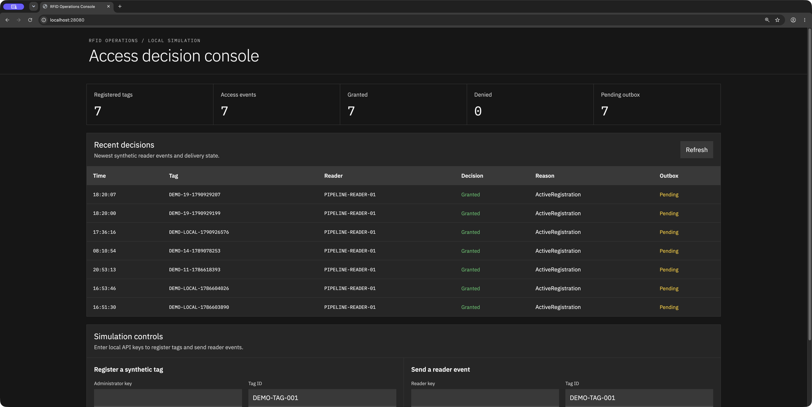

# RFID Operations Console

A .NET 10 application for registering tags, evaluating access and reviewing decisions in a web console. SQLite stores decisions and an outbox for downstream delivery.

**Status:** academic DevSecOps lab with simulated readers and local staging/production-like containers.

**My contribution:** C# application, persistence, operator console and seven-stage Jenkins delivery pipeline for Deakin SIT223 7.3HD.

[Demonstration](https://drive.google.com/file/d/1IiOHtabuf0zDHN0I_kxpE-9BG_8kJgIL/view?usp=drivesdk) · [Jenkinsfile](Jenkinsfile) · [Build results](docs/evidence/README.md)



*Historical local application capture, 2 October 2026. No physical reader is connected in this lab.*

## How it works

Active registered tags are granted access; unknown or inactive tags are denied. The API records each decision, publishes metrics and retains an acknowledgement-aware outbox.

The Jenkins pipeline builds one versioned image, tests it, checks quality/security, deploys to staging, exercises rollback/release and verifies monitoring. [Build 19](docs/evidence/build-19/README.md) used source `f896577ef3b4d88ac5d9b33bd89a48254f52b3f8` and tag [v1.0.19-f896577](https://github.com/stefan-mcf/rfid-operations-console-devsecops-lab/tree/v1.0.19-f896577). Its full stage table, logs and receipts remain in the evidence index.

## Run locally

Install the .NET 10 SDK specified in [global.json](global.json) and Docker Desktop, then clone the repository:

```bash
git clone https://github.com/stefan-mcf/rfid-operations-console-devsecops-lab.git
cd rfid-operations-console-devsecops-lab
cp .env.example .env
```

Replace the reader and administrator keys in `.env` with two different random values. Load the environment and run the tests and application:

```bash
set -a
source .env
set +a

dotnet restore RfidOperationsConsole.slnx
dotnet test RfidOperationsConsole.slnx
docker build -t "$RFID_OPS_IMAGE" .
docker compose -f deploy/compose.staging.yml up -d
```

Open <http://localhost:18080>. Use the administrator key to register a tag, then the reader key to send an event. The console shows the decision and outbox status. `.env.example` sets `RFID_OPS_IMAGE=rfid-ops:local`; keep that value or choose your own local image tag.

Stop the application with `docker compose -f deploy/compose.staging.yml down`. The named SQLite volume is retained.

For the complete pipeline, follow the [Jenkins and SonarQube setup](infra/jenkins/README.md).

## Validation

```bash
dotnet restore RfidOperationsConsole.slnx
dotnet test RfidOperationsConsole.slnx --configuration Release
```

GitHub Actions runs the current-source build/tests. This is separate from the historical seven-stage Jenkins runs and does not repeat their deployment/security/rollback evidence.

## Scope and current state

This lab uses synthetic events and local containers. The outbox has acknowledgement support but no external delivery adapter. Monitoring sends to a local receiver.

Historical SonarQube coverage excludes browser files, and Trivy results cover the configured high/critical severities. Build 19's new-code comparison used the same source revision; it is not a fresh-code comparison. See [security findings](docs/evidence/security-findings.md) for the retained qualifications.

## Documentation

- [Jenkins setup and pipeline operation](infra/jenkins/README.md)
- [Build results and stage evidence](docs/evidence/README.md)
- [Build 14 history](docs/evidence/build-14/README.md)
- [Security findings](docs/evidence/security-findings.md)
- [Source reuse information](REUSE.md)
